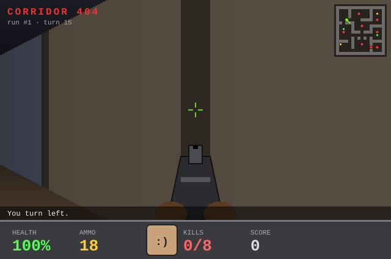

# Hi, I'm Tom 👋

Welcome to my profile. Fancy a quick game? Everyone who visits plays the same run.

## 🔫 CORRIDOR 404

<!-- GAME:START -->

|  |  |  |
|:-:|:-:|:-:|
| [↩️ Turn left](https://github.com/Tomdatbenik/tomdatbenik/issues/new?title=game%7Cturn-left&body=Just+press+%22Create%22+and+wait+about+a+minute+-+the+README+updates+itself.) | [⬆️ Forward](https://github.com/Tomdatbenik/tomdatbenik/issues/new?title=game%7Cforward&body=Just+press+%22Create%22+and+wait+about+a+minute+-+the+README+updates+itself.) | [↪️ Turn right](https://github.com/Tomdatbenik/tomdatbenik/issues/new?title=game%7Cturn-right&body=Just+press+%22Create%22+and+wait+about+a+minute+-+the+README+updates+itself.) |
| | [⬇️ Back](https://github.com/Tomdatbenik/tomdatbenik/issues/new?title=game%7Cback&body=Just+press+%22Create%22+and+wait+about+a+minute+-+the+README+updates+itself.) | [🔫 Shoot](https://github.com/Tomdatbenik/tomdatbenik/issues/new?title=game%7Cshoot&body=Just+press+%22Create%22+and+wait+about+a+minute+-+the+README+updates+itself.) |

<a href="https://github.com/Tomdatbenik/tomdatbenik/issues/new?title=game%7Cnew&body=Just+press+%22Create%22+and+wait+about+a+minute+-+the+README+updates+itself.">🔄 New game</a>

**Last move:** You turn left.

How to play · recent moves · top players

Every move is a GitHub issue. Click an action, hit **Create**, and a GitHub Action plays your move and redraws the screen (takes ~30-60s, then refresh). Anyone can play, and all moves go into one shared run. Kill every grunt to clear the sector. Grunts claw you up close and throw fireballs from afar. Shots do double damage at close range.

| Turn | Player | Move | Result |
|---|---|---|---|
| 15 | @paul-is-online | turn-left | You turn left. |
| 14 | @paul-is-online | forward | Footsteps echo down the corridor. |
| 13 | @paul-is-online | turn-right | You turn right. |
| 12 | @paul-is-online | forward | Bonk. There's a wall there. |
| 11 | @paul-is-online | forward | Bonk. There's a wall there. |
| 10 | @paul-is-online | forward | Footsteps echo down the corridor. |
| 9 | @Samdatbenik | turn-left | You turn left. |
| 8 | @Tomdatbenik | forward | Footsteps echo down the corridor. |

**Top players:** @Tomdatbenik (6), @paul-is-online (6), @Shahram-73 (2), @Samdatbenik (1)

**Runs:** 0 cleared · 0 lost

<!-- GAME:END -->
