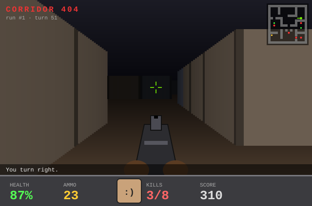
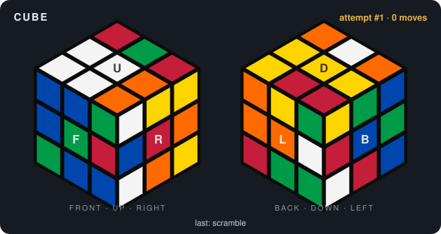

# Hi, I'm Tom 👋

Welcome to my profile. Fancy a quick game? Everyone who visits plays the same run.

## 🔫 CORRIDOR 404

<!-- GAME:START -->

|  |  |  |
|:-:|:-:|:-:|
| [↩️ Turn left](https://github.com/Tomdatbenik/tomdatbenik/issues/new?title=game%7Cturn-left&body=Just+press+%22Create%22+and+wait+about+a+minute+-+the+README+updates+itself.) | [⬆️ Forward](https://github.com/Tomdatbenik/tomdatbenik/issues/new?title=game%7Cforward&body=Just+press+%22Create%22+and+wait+about+a+minute+-+the+README+updates+itself.) | [↪️ Turn right](https://github.com/Tomdatbenik/tomdatbenik/issues/new?title=game%7Cturn-right&body=Just+press+%22Create%22+and+wait+about+a+minute+-+the+README+updates+itself.) |
| | [⬇️ Back](https://github.com/Tomdatbenik/tomdatbenik/issues/new?title=game%7Cback&body=Just+press+%22Create%22+and+wait+about+a+minute+-+the+README+updates+itself.) | [🔫 Shoot](https://github.com/Tomdatbenik/tomdatbenik/issues/new?title=game%7Cshoot&body=Just+press+%22Create%22+and+wait+about+a+minute+-+the+README+updates+itself.) |

<a href="https://github.com/Tomdatbenik/tomdatbenik/issues/new?title=game%7Cnew&body=Just+press+%22Create%22+and+wait+about+a+minute+-+the+README+updates+itself.">🔄 New game</a>

**Last move:** You turn right.

How to play · recent moves · top players

Every move is a GitHub issue. Click an action, hit **Create**, and a GitHub Action plays your move and redraws the screen (takes ~30-60s, then refresh). Anyone can play, and all moves go into one shared run. Kill every grunt to clear the sector. Grunts claw you up close and throw fireballs from afar. Shots do double damage at close range.

| Turn | Player | Move | Result |
|---|---|---|---|
| 51 | @paul-is-online | turn-right | You turn right. |
| 50 | @paul-is-online | turn-right | You turn right. |
| 49 | @paul-is-online | forward | Bonk. There's a wall there. |
| 48 | @paul-is-online | forward | Footsteps echo down the corridor. |
| 47 | @paul-is-online | forward | Footsteps echo down the corridor. |
| 46 | @paul-is-online | turn-left | You turn left. |
| 45 | @paul-is-online | turn-left | You turn left. |
| 44 | @paul-is-online | turn-left | You turn left. |

**Top players:** @paul-is-online (42), @Tomdatbenik (6), @Shahram-73 (2), @Samdatbenik (1)

**Runs:** 0 cleared · 0 lost

<!-- GAME:END -->

## 🧊 Cube

<!-- CUBE:START -->

| Face | Clockwise | Anticlockwise | Double |
|:-:|:-:|:-:|:-:|
| **U** (Up) | [`U`](https://github.com/Tomdatbenik/tomdatbenik/issues/new?title=cube%7CU&body=Just+press+%22Create%22+and+wait+about+a+minute+-+the+README+updates+itself.) | [`U'`](https://github.com/Tomdatbenik/tomdatbenik/issues/new?title=cube%7CU%27&body=Just+press+%22Create%22+and+wait+about+a+minute+-+the+README+updates+itself.) | [`U2`](https://github.com/Tomdatbenik/tomdatbenik/issues/new?title=cube%7CU2&body=Just+press+%22Create%22+and+wait+about+a+minute+-+the+README+updates+itself.) |
| **D** (Down) | [`D`](https://github.com/Tomdatbenik/tomdatbenik/issues/new?title=cube%7CD&body=Just+press+%22Create%22+and+wait+about+a+minute+-+the+README+updates+itself.) | [`D'`](https://github.com/Tomdatbenik/tomdatbenik/issues/new?title=cube%7CD%27&body=Just+press+%22Create%22+and+wait+about+a+minute+-+the+README+updates+itself.) | [`D2`](https://github.com/Tomdatbenik/tomdatbenik/issues/new?title=cube%7CD2&body=Just+press+%22Create%22+and+wait+about+a+minute+-+the+README+updates+itself.) |
| **F** (Front) | [`F`](https://github.com/Tomdatbenik/tomdatbenik/issues/new?title=cube%7CF&body=Just+press+%22Create%22+and+wait+about+a+minute+-+the+README+updates+itself.) | [`F'`](https://github.com/Tomdatbenik/tomdatbenik/issues/new?title=cube%7CF%27&body=Just+press+%22Create%22+and+wait+about+a+minute+-+the+README+updates+itself.) | [`F2`](https://github.com/Tomdatbenik/tomdatbenik/issues/new?title=cube%7CF2&body=Just+press+%22Create%22+and+wait+about+a+minute+-+the+README+updates+itself.) |
| **B** (Back) | [`B`](https://github.com/Tomdatbenik/tomdatbenik/issues/new?title=cube%7CB&body=Just+press+%22Create%22+and+wait+about+a+minute+-+the+README+updates+itself.) | [`B'`](https://github.com/Tomdatbenik/tomdatbenik/issues/new?title=cube%7CB%27&body=Just+press+%22Create%22+and+wait+about+a+minute+-+the+README+updates+itself.) | [`B2`](https://github.com/Tomdatbenik/tomdatbenik/issues/new?title=cube%7CB2&body=Just+press+%22Create%22+and+wait+about+a+minute+-+the+README+updates+itself.) |
| **L** (Left) | [`L`](https://github.com/Tomdatbenik/tomdatbenik/issues/new?title=cube%7CL&body=Just+press+%22Create%22+and+wait+about+a+minute+-+the+README+updates+itself.) | [`L'`](https://github.com/Tomdatbenik/tomdatbenik/issues/new?title=cube%7CL%27&body=Just+press+%22Create%22+and+wait+about+a+minute+-+the+README+updates+itself.) | [`L2`](https://github.com/Tomdatbenik/tomdatbenik/issues/new?title=cube%7CL2&body=Just+press+%22Create%22+and+wait+about+a+minute+-+the+README+updates+itself.) |
| **R** (Right) | [`R`](https://github.com/Tomdatbenik/tomdatbenik/issues/new?title=cube%7CR&body=Just+press+%22Create%22+and+wait+about+a+minute+-+the+README+updates+itself.) | [`R'`](https://github.com/Tomdatbenik/tomdatbenik/issues/new?title=cube%7CR%27&body=Just+press+%22Create%22+and+wait+about+a+minute+-+the+README+updates+itself.) | [`R2`](https://github.com/Tomdatbenik/tomdatbenik/issues/new?title=cube%7CR2&body=Just+press+%22Create%22+and+wait+about+a+minute+-+the+README+updates+itself.) |

<a href="https://github.com/Tomdatbenik/tomdatbenik/issues/new?title=cube%7Cscramble&body=Just+press+%22Create%22+and+wait+about+a+minute+-+the+README+updates+itself.">🎲 Scramble</a>

**Last move:** @Tomdatbenik scrambled the cube: F2 L2 F U2 L2 R2 D R B F B2 U F D2 L' B2 L2 U2 D' B

How to play · recent moves · solvers

Standard notation: a letter turns that face a quarter turn clockwise *as you look at that face*, `'` turns it anticlockwise and `2` turns it twice. The left picture shows the front, top and right faces, and the right picture shows the cube flipped over to the back, bottom and left. Scramble starts a counted attempt. Pro tip: open an issue titled `cube|R U R' U'` to play up to 20 moves at once.

| Moves | Player | Played |
|---|---|---|
| 0 | @Tomdatbenik | `scramble` |

**Solvers:** nobody yet. Be the first!

**Solves:** 0

<!-- CUBE:END -->
